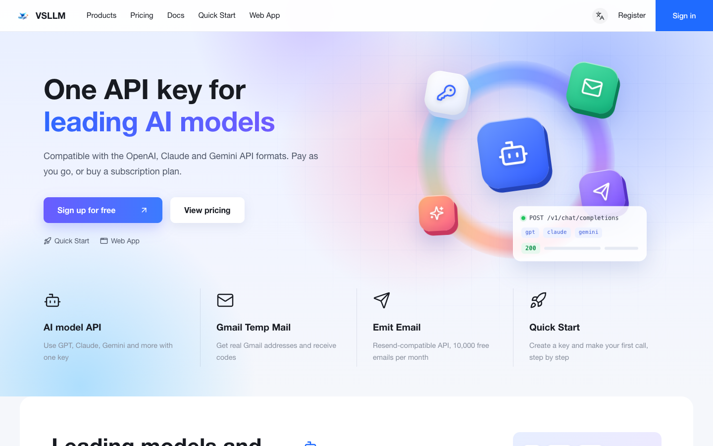
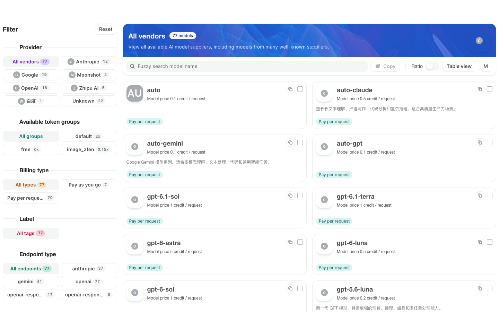
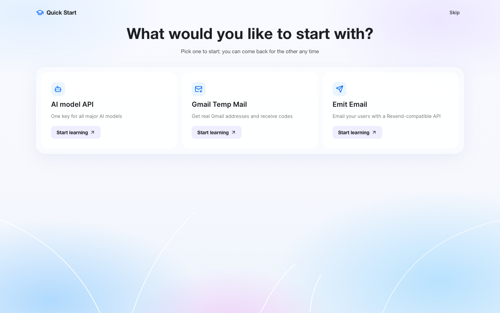

# VSLLM 价格指南：按次 API 适不适合 Codex 与 Claude Code？

如果你主要使用 Codex、Claude Code，不想每天计算百万 Token，VSLLM 的按次模型值得重点比较。价格页把“每次请求多少”直接写在模型卡片上，同时标注端点类型，适合用固定任务快速做成本对照。

[打开 VSLLM 注册与价格页](https://vsllm.cc/i/njv6)

## 先用一个真实任务算成本

选一个常见仓库任务，例如读取三个文件、修改一个函数、运行测试。分别用低价模型和高阶模型完成，记录调用次数、完成质量和总扣费。按次 API 的价值就在这里：只要任务形态稳定，一周成本很容易估算。

公开页面当前显示 77 个模型，可按供应商、分组、计费类型和端点筛选。Code Agent 用户应优先筛选 OpenAI/Responses 或 Anthropic 端点，不必浏览全部模型。

## Codex 的购买路线

第一阶段选择价格低、支持工具调用的 OpenAI 路线，跑短修改与测试；第二阶段用更强模型处理跨文件重构；第三阶段才考虑将日常仓库任务长期迁入。每个项目单独 Key，能防止某个自动化循环快速消耗余额。

## Claude Code 的购买路线

选择 Claude 与 Anthropic 端点，先完成消息、流式、编辑和工具调用四类任务。轻量修改优先快速模型，复杂架构分析再用高阶模型。按次价格适合把高阶模型留给少量关键任务。

## 充值流程

通过入口注册，登录控制台打开钱包或充值页面，选择页面提供的金额和支付方式。首充按一周预计请求次数准备。到账后创建两把 Key：一把给 Codex，一把给 Claude Code；从价格页复制精确模型 ID，再按快速指南配置。

## 与月卡方案相比

按次适合用量波动大、任务可控的人；月卡适合每天高频、任务量稳定的人。VSLLM 的优势是可以从极小请求量起步，不必先承诺整月消费。等一周数据出来后，再决定继续按次还是换固定套餐。

## 哪些任务最划算

- 固定长度代码审查；
- 结构化提取与分类；
- 短文本改写；
- 小仓库修改与测试；
- 偶尔调用高阶模型解决难题。

长上下文、多轮工具循环、超长生成要单独测，因为一次请求内部的工作量可能差异很大。

## FAQ

### VSLLM 适合双工具用户吗？
适合。用两把 Key 分别接 Codex 和 Claude Code，能直接比较成本。

### 模型越便宜越好吗？
不是。完成率低会带来重试。比较同一任务的最终成本与质量。

### 首次充值后先做什么？
复制精确模型 ID，用小仓库完成一次端到端任务，并查看扣费记录。

[进入 VSLLM，用真实代码任务测试按次 API](https://vsllm.cc/i/njv6)
